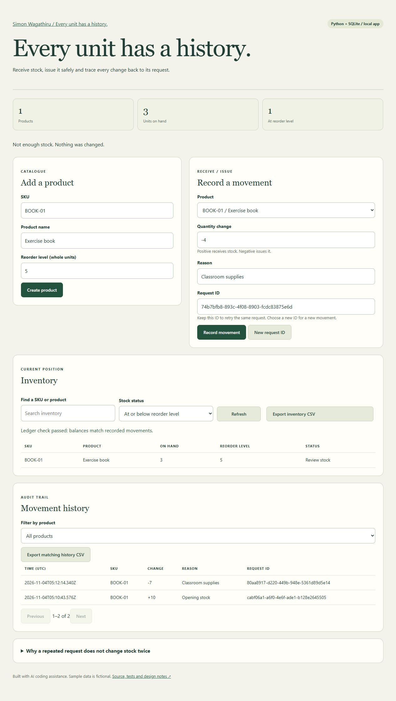

# Stock Ledger

A Python/SQLite inventory application with a browser interface, durable movement history, reorder levels, filtered history and CSV exports. Receive and issue whole units without overselling or applying an identical request twice. Uses only the Python standard library.

## Run
Requires Python 3.10 or newer. Run `python server.py` (`py -3 server.py` on Windows), then open **http://127.0.0.1:8095**. Opening index.html directly will not connect to the API. The server deliberately accepts only its printed 127.0.0.1 host and port.

Use `python server.py --port 8096 --db demo.sqlite3` for a separate database. Existing v1 databases migrate in place by adding a default reorder level of zero. Back up important data before upgrading.

## Three-minute demonstration
1. Create BOOK-01 / Exercise book with reorder level 5.
2. Receive 10 with reason Opening stock and a request ID.
3. Submit the same movement again. The server reports a replay and stock stays 10.
4. Choose **New request ID**, issue 7 with a reason. Stock becomes 3; the low-stock filter finds the product.
5. Attempt to issue 4 using another new ID. The operation is rejected and stock remains 3.
6. Filter movement history by the product and export the CSV. Compare the inventory balance with the recorded changes.

## Test
Run `python -m unittest discover -v` from this directory. There are 20 tests: 12 domain/database tests plus 8 real HTTP integration tests using an ephemeral local server and temporary databases. Coverage includes concurrent withdrawals, forced rollback, persistence, idempotency conflicts, HTTP validation, origin/host rejection, pagination, CSV quoting and formula-prefix neutralization, migration and a backup round trip.

## Back up and recover
`python backup.py inventory.sqlite3 backups-2026-11-04.sqlite3` creates a consistent snapshot using SQLite's backup API. The destination must not exist. Keep backups outside the application folder.

To recover, stop the server, preserve the current database, then start against a known backup with `python server.py --db backups-2026-11-04.sqlite3`. The server writes to the selected file; make another copy first if you want to retain an immutable backup. No automatic or cloud backup is included.

## API
See API.md for routes, schemas, examples and retry behavior. CSV text fields beginning with spreadsheet formula prefixes are prefixed with an apostrophe; that is an intentional export transformation. History uses offset pagination and may shift when new movements arrive.

## Design
The write transaction takes SQLite's writer lock before checking stock. A stock change and its history entry commit together. A unique request ID replays the original result for identical input; changed payloads under the same ID are rejected. Reconciliation reads a consistent snapshot of inventory and history. Read history is paginated with a maximum page size of 100.

## Boundaries
Single-computer learning application. No accounts, roles, internet deployment hardening, automatic backups, pagination snapshot tokens, valuation or payment processing. A database administrator can alter history. CSV exports are generated in memory and are intended for modest local datasets. This is not a production inventory service.

Created with AI coding assistance for Simon Wagathiru. The repository includes actual test and interface evidence, without customer or adoption claims.

## Interface evidence

